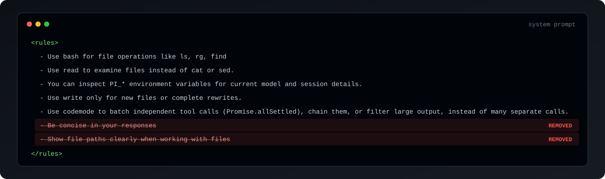

# pi-remove-concise-and-filepath-rules

Pi extension that removes 2 of Pi's built-in system prompt rules.

- **Removes `Be concise in your responses`** from Pi's rules 
- **Removes `Show file paths clearly when working with files`** from Pi's rules.
- **Raises Codex verbosity**: `text.verbosity` from Pi's default `low` to `medium` (this is ChatGPT default)

At least in my tests "be concise" rule caused confusion when multiple skills and prompts tried to explain what type of output style they want, removing this helps keep models defaults and drive style ouput via personal skills or promtps instead.